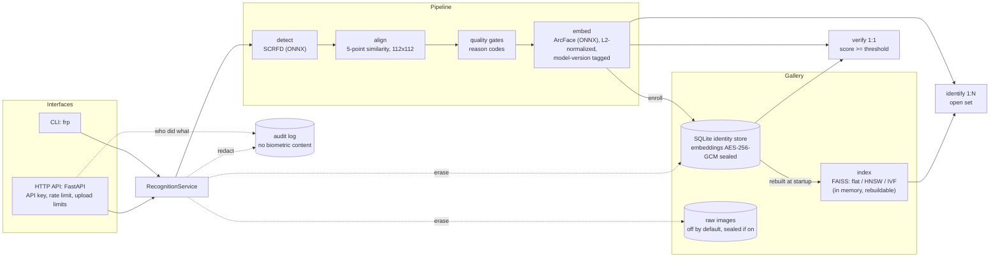

# face-recognition-pipeline

A benchmarked, privacy-aware face recognition pipeline (detect, align, embed, index, verify 1:1, identify 1:N) behind a small HTTP API and CLI, where every number comes from a script.

[](https://github.com/DanyVX/face-recognition-pipeline/actions/workflows/ci.yml)

-green)


> **Model license notice (read this first).** The code in this repo is MIT-licensed. The pretrained
> face models it depends on (InsightFace `buffalo_l` pack: SCRFD detector and ArcFace embedder) are,
> per the InsightFace README, available for **non-commercial research purposes only**. Do **not**
> treat this project as commercially deployable. The pack ships no license text of its own, and the
> README statement was read through a summarizing tool, so the primary text still has to be re-read
> before any release. Details and unverified items: [`MODEL_CARD.md`](MODEL_CARD.md).
>
> **Dataset terms are unverified.** LFW (used for the benchmarks) has no explicit license text that I
> could find; its own page says it should not be used to conclude that an algorithm is suitable for
> any commercial purpose. Treat it as research-only and never redistribute it. See [`DATA.md`](DATA.md).

> **Not a surveillance tool.** Faces and embeddings are sensitive biometric data. This project is for
> research and education only. There is **no liveness / anti-spoofing**: a photo of an enrolled person
> will likely verify.

> **Status: pre-release, no tag yet.** Milestones M0 to M8 are implemented on branches (see
> [`CHANGELOG.md`](CHANGELOG.md)); M9 (final docs, demo, `v0.1.0`) is not done. Demo GIF: TBD.
> The Docker setup is written but not yet built or verified locally (see [Docker](#docker)).

## Key results

<!-- RESULTS:START -->
| Metric | Result | Source |
|---|---|---|
| LFW verification accuracy (10-fold, threshold from the other 9 folds) | 99.50% +/- 0.45% (std over folds) | `results/lfw_verification.json` |
| LFW EER / AUC | 0.30% / 0.9994 | same |
| TAR @ FAR=0.001: standard protocol / extended impostors | 99.33% / 99.33% (FAR measured 1.3e-03) | same |
| TAR @ FAR=0.0001: standard protocol / extended impostors | not resolvable (needs FAR < 3.3e-04) / 99.23% (FAR measured 1.8e-04) | same |
| Face detection failure rate (LFW images) | 20 of 13233 images (0.15%); failed pairs are counted as errors | same |
| Open-set rank-1 (closed-set) vs FNIR @ FPIR=1e-1 / 1e-2 | 99.80% vs 0.49% / 0.57% | `results/open_set.json` |
| CPU latency p50 / p95, 250x250 image: detect | 387.1 ms / 459.3 ms | `results/latency.json` |
| CPU latency p50 / p95: embed (batch 1) | 298.2 ms / 403.4 ms | same |
| GPU latency | TBD (not yet measured): no CUDA provider on this machine | same |
<!-- RESULTS:END -->

The table above is generated by `bench/report.py` from `results/*.json` (each file records hardware,
library versions and the git commit). If it says TBD, the report has not been run yet. Nothing in
this README is a hand-typed benchmark number. Full tables and plots will be in
[`docs/RESULTS.md`](docs/RESULTS.md).

## Why this exists

Most face-recognition demos stop at "it recognizes faces". This repo is about the parts that tend to
get skipped: honest evaluation (standard LFW 10-fold protocol, open-set identification instead of
closed-set rank-1 alone, detection failures counted as errors, small-sample uncertainty reported),
version-tagged embeddings so that mixing model versions is impossible, and privacy controls for
biometric data (encryption at rest, audit log, verified erasure). It is a portfolio project: I am
a third-year CS student, and I try to document what does not work as clearly as what does
([`docs/LIMITATIONS.md`](docs/LIMITATIONS.md)).

## Architecture



Detector and embedder sit behind `FaceDetector` / `FaceEmbedder` protocols so backends can be
swapped; SQLite is the source of truth and FAISS is a rebuildable accelerator. Decisions and
trade-offs: [`docs/DESIGN.md`](docs/DESIGN.md).

## Quickstart

Requires [uv](https://docs.astral.sh/uv/) and git. Python 3.11+ (developed on 3.12).

```bash
git clone https://github.com/DanyVX/face-recognition-pipeline.git
cd face-recognition-pipeline
uv sync                                          # runtime + dev + bench dependencies
uv run python scripts/download_models.py         # InsightFace models into models/, SHA-256 verified (fetches the ~289 MB buffalo_l.zip)
uv run frp env                                   # hardware/library/git info as JSON
```

`scripts/download_models.py --list` shows the known model files and their licenses. The models are
for **non-commercial research use only** (see the notice above) and are never committed.

The service and the enrollment commands need an encryption key and refuse to start without one.
Generate one and export it (the key is printed, not stored anywhere):

```bash
uv run frp keys generate-encryption-key --id k1  # prints k1:BASE64...
export ENCRYPTION_KEYS="k1:BASE64..."            # PowerShell: $env:ENCRYPTION_KEYS = "k1:BASE64..."
uv run frp check-config                          # "configuration OK" if the config is valid
```

For a throwaway local experiment you can skip encryption with `ALLOW_UNENCRYPTED=true`
(development only: embeddings are then stored in plaintext and the service logs a warning). You can
also put these in a `.env` file (copy `.env.example`).

Developer tasks (cross-platform, no `make` needed on Windows; `make <task>` calls the same script):

```bash
uv run python scripts/dev.py setup        # uv sync + pre-commit install
uv run python scripts/dev.py test         # pytest with coverage (default suite needs no network or GPU)
uv run python scripts/dev.py --help       # lint, format, typecheck, test-fast, bench, bench-smoke, run, docker-build, clean
```

I have not timed a fresh-clone quickstart end to end, so the "works in under 5 minutes" target from
my own rules is **not yet verified**.

## Usage

### CLI

```bash
# enroll a person from one or more photos (all-or-nothing; several faces in a photo is rejected)
uv run frp enroll alice1.jpg alice2.jpg --name "Alice"
uv run frp enroll alice3.jpg --name "Alice" --identity-id <id> --append

# 1:1 verification: two photos, or one photo against an enrolled identity
uv run frp verify a.jpg b.jpg
uv run frp verify probe.jpg --identity <id> --threshold 0.45

# 1:N open-set identification (match is null unless the best score reaches the threshold)
uv run frp identify probe.jpg --k 5

uv run frp list                     # identities (ids, names, counts; never embeddings)
uv run frp delete <id>              # remove an identity and its embeddings
uv run frp erase --identity <id>    # full, verified erasure (run with the service stopped)
uv run frp debug-align face.jpg     # overlay PNG of detection + alignment (contains a face: sensitive)
uv run frp audit --limit 20         # recent audit events
```

Scores are cosine similarity and a pair is accepted when `score >= threshold`. The shipped default
thresholds are **provisional placeholders**; choose yours from your own data
(see [`docs/LIMITATIONS.md`](docs/LIMITATIONS.md)).

### HTTP API

```bash
uv run frp keys create --name demo     # prints an API key ONCE
uv run frp serve                       # models load in the background; wait for /readyz
export KEY=frp_xxxxxxxx_...            # the key you created

curl http://127.0.0.1:8000/readyz

curl -H "X-API-Key: $KEY" -H "Idempotency-Key: enroll-alice-1" \
  -F images=@alice1.jpg -F images=@alice2.jpg -F name=Alice \
  http://127.0.0.1:8000/v1/enroll

curl -H "X-API-Key: $KEY" -F image=@probe.jpg -F k=3 http://127.0.0.1:8000/v1/identify
curl -H "X-API-Key: $KEY" -F image_a=@a.jpg -F image_b=@b.jpg http://127.0.0.1:8000/v1/verify
curl -H "X-API-Key: $KEY" -F image_a=@probe.jpg -F identity_id=<id> http://127.0.0.1:8000/v1/verify
curl -X DELETE -H "X-API-Key: $KEY" http://127.0.0.1:8000/v1/identities/<id>
```

Endpoints: `POST /v1/enroll`, `POST /v1/verify`, `POST /v1/identify`,
`DELETE /v1/identities/{id}`, `GET /healthz`, `GET /readyz`, `GET /metrics` (Prometheus). Interactive
docs are served at `/docs`. Error schema, error codes and operational notes:
[`docs/API.md`](docs/API.md). The service speaks plain HTTP; put a TLS-terminating reverse proxy in
front of it.

## Configuration

All configuration is read from environment variables (or a `.env` file), validated at startup, and
fails fast with a message. Every variable is documented in [`.env.example`](.env.example): logging,
detection limits, ONNX providers, gallery and matching, API limits, encryption and audit. Variables
have no prefix (for example `ENCRYPTION_KEYS`, `STORE_RAW_IMAGES`; see D-004 in the design log).
`uv run frp check-config` validates the current environment.

## Reproducing the benchmarks

Benchmarks are staged and cached: images are detected and aligned once, embedded once, and the
evaluators then read the caches. Every stage writes `results/<name>.json` with environment info and
the git commit, and `bench/report.py` renders those files into `docs/RESULTS.md`, plots, and the
table between the `RESULTS` markers above.

```bash
uv run python scripts/download_models.py
uv run python scripts/download_lfw.py            # ~173 MB, SHA-256 and md5 verified, into data/lfw/
uv run python scripts/dev.py bench-smoke         # tiny path: synthetic index benchmark, reduced LFW run if data is present
uv run python scripts/dev.py bench               # full suite; hours on a CPU-only laptop, every step resumable
```

`bench` runs, in order: `bench.prepare_lfw`, `bench.embed_lfw`, `bench.lfw_verification`,
`bench.open_set`, `bench.index_scaling`, `bench.latency`, `bench.precision`, `bench.robustness`,
`bench.calibrate_quality`, `bench.report` (each as `uv run python -m bench.<name>`). The smoke path
never overwrites real results. The development machine is CPU-only (2 cores, about 8 GB RAM);
GPU rows stay `TBD (not yet measured)` until a result produced on a GPU is committed. Steps for
Colab/Kaggle are in [`docs/COLAB.md`](docs/COLAB.md) (also unverified: not run yet).

Evaluation discipline: thresholds are chosen on training/validation data only and applied to
held-out data; failed detections count as errors instead of being dropped; small samples are
reported with confidence intervals. Details are in decision D-023 of the design log.

## Docker

> **Written but not yet built or verified locally.** The development machine has no Docker. The
> `Dockerfile`, `docker-compose.yml` and `scripts/docker-entrypoint.sh` have never been run by me;
> the CI `docker` job is meant to be their first build, and I do not claim it is green.

Intended use:

```bash
docker compose up --build
docker compose exec frp frp keys create --name demo     # prints an API key once
```

Design intent (unverified until it runs): non-root user, read-only root filesystem with writable
volumes for `/data` and `/models` and a tmpfs for `/tmp`, all capabilities dropped, port bound to
loopback. The model weights are **not** baked into the image (license); the entrypoint downloads
and checksum-verifies them into the `/models` volume on first start. The compose file sets
`ALLOW_KEY_GENERATION=true`, which stores the key next to the data: demo only, it protects nothing
against theft of the host.

## Design decisions

The short version (full log with options considered and trade-offs: [`docs/DESIGN.md`](docs/DESIGN.md)):

- **Own SCRFD decode and Umeyama alignment** instead of the `insightface` package or RANSAC-based
  OpenCV estimators: deterministic, testable, fewer dependencies (D-007, D-011).
- **Alignment and quality gates fail loudly** with stable reason codes instead of embedding garbage
  (D-012, D-022).
- **Embeddings are version-tagged by construction**; comparing different model versions raises
  (D-014).
- **SQLite is the source of truth, FAISS a rebuildable accelerator**; deletion cost on HNSW/IVF is
  the price of that simplicity (D-018, D-020).
- **One service layer behind both the API and the CLI** so the two cannot drift (D-024).
- **AES-256-GCM at rest with a keyring and rotation**, and no silent plaintext fallback (D-028).
- **Erasure is an orchestrated and verified operation**, not just a row delete (D-030).

## Privacy and security

Biometric data is treated as sensitive by default: no raw images are stored (`STORE_RAW_IMAGES=false`),
embeddings are never logged and are returned over the API only if the operator enables
`RETURN_EMBEDDINGS` and the caller asks, embeddings and index snapshots are sealed with AES-256-GCM,
and the audit log records who did what without biometric content. Erasure removes a person from rows,
vectors, sealed raw images, registered snapshots and replay records, redacts the audit log, and verifies
the result.

- [`docs/THREAT_MODEL.md`](docs/THREAT_MODEL.md): STRIDE-lite threat model. It is a design-level
  analysis by the author, not a penetration test or an audit; nothing has been reviewed by a third party.
- [`docs/SECURITY_OPERATIONS.md`](docs/SECURITY_OPERATIONS.md): key generation and rotation, erasure
  and what it cannot reach, audit log, raw images, container hardening, pre-flight checklist.
- [`SECURITY.md`](SECURITY.md): reporting.

Honest scope: names, identity ids and timestamps are not encrypted; keys come from the environment
or a file (no KMS/HSM); a lost key means a lost gallery; erasure cannot reach backups. This repo
offers technical controls, not a legal compliance claim.

## Limitations

Full list, including negative results and edge cases not covered:
[`docs/LIMITATIONS.md`](docs/LIMITATIONS.md). The headline ones:

- **Non-commercial models** and unverified LFW terms (see the notices at the top).
- **No liveness or anti-spoofing**, and **no demographic fairness evaluation**. Nothing here is a
  fairness claim.
- **LFW is near-saturated and demographically skewed**, so a high score there says little about
  real-world performance.
- **Default thresholds are provisional**; quality-gate defaults are lenient until calibrated
  thresholds are produced and loaded.
- **Single process, single node**: the gallery lock, rate limiter and idempotency locks are per
  process; unauthenticated traffic is not rate limited.
- **Measured on one CPU-only machine**; GPU behavior and cross-machine determinism are not measured.
- **Scores are returned to authenticated callers**, which enables threshold probing; rate limits
  slow it down but do not stop it.
- **Docker artifacts are unverified locally.**
- Names and metadata are not encrypted; backups are outside erasure.

## Roadmap

- M9: final docs, demo GIF (consenting or license-clear faces only), results table filled in
  README, `v0.1.0` tag. (Demo GIF: TBD.)
- Verify the Docker build and compose flow, and the fresh-clone quickstart timing.
- Second, open-license model backend behind the same interface (not yet investigated; see
  [`MODEL_CARD.md`](MODEL_CARD.md)).
- Harder verification sets (CFP-FP, AgeDB-30): access terms unverified, currently a documented gap.
- GPU measurements (Colab/Kaggle), per [`docs/COLAB.md`](docs/COLAB.md).
- Liveness / anti-spoofing is out of scope here (planned for a separate repo).

## Documents

- [`CLAUDE.md`](CLAUDE.md): engineering rules for this repo
- [`docs/PROJECT_SPEC.md`](docs/PROJECT_SPEC.md): project specification and milestones
- [`docs/DESIGN.md`](docs/DESIGN.md): architecture and decision log
- [`docs/RESULTS.md`](docs/RESULTS.md), [`docs/LIMITATIONS.md`](docs/LIMITATIONS.md),
  [`docs/API.md`](docs/API.md), [`docs/THREAT_MODEL.md`](docs/THREAT_MODEL.md),
  [`docs/SECURITY_OPERATIONS.md`](docs/SECURITY_OPERATIONS.md), [`docs/COLAB.md`](docs/COLAB.md)
- [`DATA.md`](DATA.md), [`MODEL_CARD.md`](MODEL_CARD.md), [`CHANGELOG.md`](CHANGELOG.md),
  [`CONTRIBUTING.md`](CONTRIBUTING.md)

## License

Code: MIT (see [`LICENSE`](LICENSE)). Models and datasets carry their own licenses and are **not**
covered by the MIT license: the InsightFace pretrained models are non-commercial research use only,
and LFW's terms are unverified (see the notices at the top, [`MODEL_CARD.md`](MODEL_CARD.md) and
[`DATA.md`](DATA.md)).

## Acknowledgements and citations

- **InsightFace** (<https://github.com/deepinsight/insightface>): the `buffalo_l` model pack
  provides the SCRFD detector (`det_10g.onnx`) and the ArcFace ResNet-50 embedder
  (`w600k_r50.onnx`) used here. Code is MIT; the pretrained models are non-commercial research use
  only (see `MODEL_CARD.md`).
- **Labeled Faces in the Wild (LFW)** (<http://vis-www.cs.umass.edu/lfw/>): used for verification
  and open-set benchmarks; downloaded by script, never redistributed (see `DATA.md`).
- **scikit-learn**: its pinned figshare checksums were used to verify the LFW mirror (see `DATA.md`).
- **FAISS** (`faiss-cpu`) is used for vector search and is a dependency in `pyproject.toml`.
- **NASA Great Images database** via `skimage.data.astronaut()`: public-domain test fixture
  (see `DATA.md`).

Formal paper citations (SCRFD, ArcFace, LFW, FAISS) are TBD: I will copy them from the primary
sources rather than from memory.
