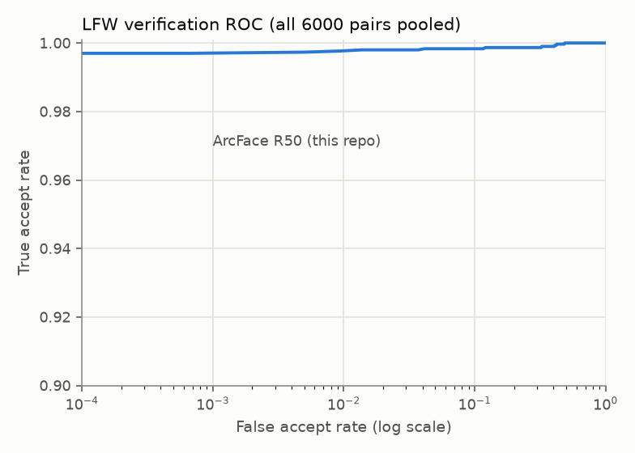
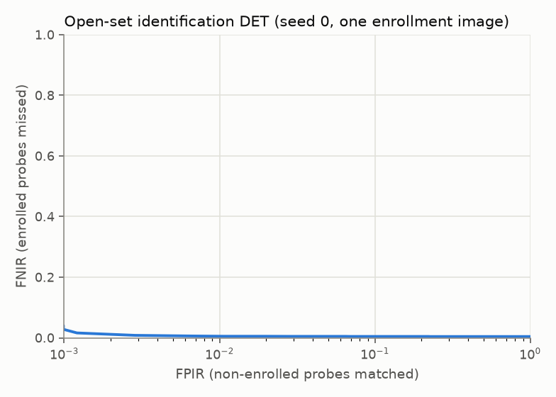
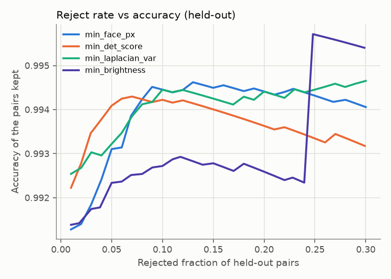
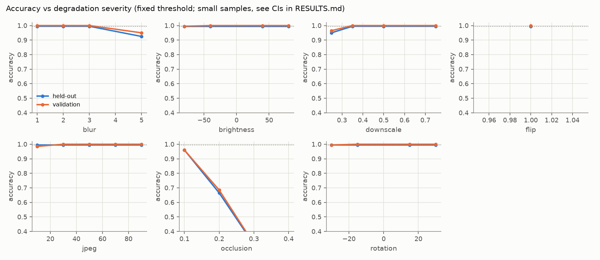
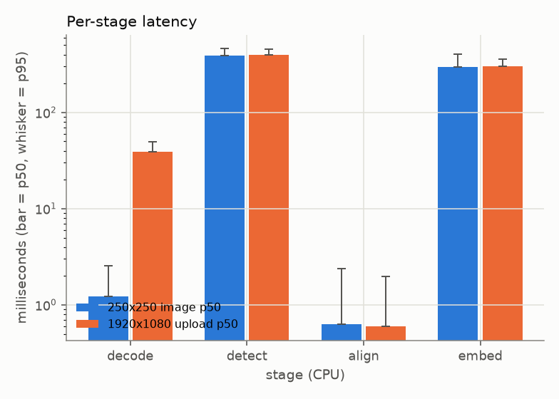
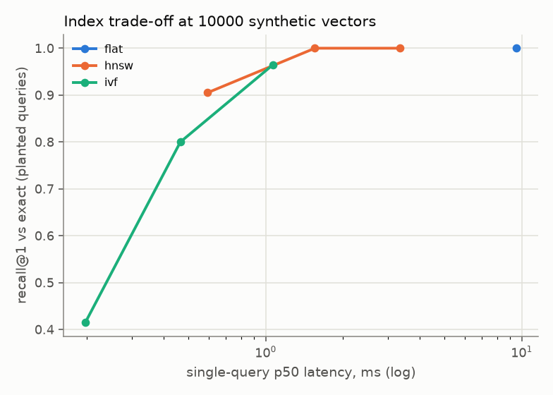

# Results

Generated by `bench/report.py` from `results/*.json`. **Do not edit by hand.** Every number comes from a result file that records hardware, library versions and the git commit; anything not yet measured is marked `TBD (not yet measured)`.

## Key results

| Metric | Result | Source |
|---|---|---|
| LFW verification accuracy (10-fold, threshold from the other 9 folds) | 99.50% +/- 0.45% (std over folds) | `results/lfw_verification.json` |
| LFW EER / AUC | 0.30% / 0.9994 | same |
| TAR @ FAR=0.001: standard protocol / extended impostors | 99.33% / 99.33% (FAR measured 1.3e-03) | same |
| TAR @ FAR=0.0001: standard protocol / extended impostors | not resolvable (needs FAR < 3.3e-04) / 99.23% (FAR measured 1.8e-04) | same |
| Face detection failure rate (LFW images) | 20 of 13233 images (0.15%); failed pairs are counted as errors | same |
| Open-set rank-1 (closed-set) vs FNIR @ FPIR=1e-1 / 1e-2 | 99.80% vs 0.49% / 0.57% | `results/open_set.json` |
| CPU latency p50 / p95, 250x250 image: detect | 387.1 ms / 459.3 ms | `results/latency.json` |
| CPU latency p50 / p95: embed (batch 1) | 298.2 ms / 403.4 ms | same |
| GPU latency | TBD (not yet measured): no CUDA provider on this machine | same |

## LFW verification (1:1)

Run `24398214` (uncommitted changes), 2026-10-01T19:05:00+00:00. Model `insightface-buffalo_l/w600k_r50@4c06341c33c2/arcface-rgb-127.5-v1`. Multi-face policy: center.

- Accuracy (10-fold): **99.50% +/- 0.45%** (std over folds; SEM 0.14%). Failed pairs count as errors; accuracy on valid pairs only: 99.82%.
- Detection failures: 19 of 6000 pairs (0.32%).
- Pooled EER 0.30% (failure-aware 0.63%), AUC 0.9994.
- Leakage check: passed (0 identities in several folds, 0 shared images).

| FAR target | Standard protocol TAR | Extended-impostor TAR (FAR measured) |
|---|---|---|
| 0.001 | 99.33% | 99.33% +/- 0.54% (1.3e-03) |
| 0.0001 | not resolvable (floor 3.3e-04) | 99.23% +/- 0.55% (1.8e-04) |

The standard protocol has 3000 impostor pairs, so FAR below about 3.3e-4 cannot be measured there; the *extended* column uses every cross-identity image pair and is **not** part of the standard protocol.
LFW is near-saturated and demographically skewed; nothing here says anything about fairness.

## Open-set identification (1:N)

Run `24398214` (uncommitted changes), 2026-10-01T19:05:52+00:00. Mean +/- std over seeded enrolled/non-enrolled splits.

| Experiment | Rank-1 (closed-set) | FNIR @ FPIR 1e-1 | FNIR @ FPIR 1e-2 | non-mated probes |
|---|---|---|---|---|
| enroll1_max | 99.80% +/- 0.08% | 0.49% | 0.57% | 8764 |
| enroll3_max | 99.90% +/- 0.04% | 0.30% | 0.32% | 9860 |
| enroll3_mean | 99.90% +/- 0.04% | 0.30% | 0.30% | 9860 |
| enroll1_max_hnsw | 99.80% +/- 0.08% | 0.49% | 0.57% | 8764 |

Closed-set rank-1 only asks whether an enrolled person's best match is correct. It ignores people who are not enrolled, which is the case that matters when a system must say 'nobody here'; FNIR at a fixed FPIR measures that, and is the number to read.

## Quality gates

Run `24398214` (uncommitted changes), 2026-10-01T20:18:11+00:00. Method: fixed decision threshold 0.2246 from clean validation pairs; thresholds chosen on a validation set (clean pairs of folds 0-1 plus degraded probes) by cross-fitted gain with a Bonferroni-corrected CI; evaluated once on held-out folds 2-9 plus degraded test probes.

Calibrated gates kept: {'min_det_score': 0.7475247144699096, 'min_laplacian_var': 16.611534602705277}.
Held-out: accuracy of all pairs 99.14%, reject rate 11.87%, accuracy of kept pairs 99.58%.

## Robustness slices

Run `24398214` (uncommitted changes), 2026-10-01T20:17:57+00:00. Fixed threshold 0.2246 (best-accuracy threshold on clean validation pairs (folds 0-1)). Samples: {'val': 200, 'test': 200}. **Small samples**: differences of a few points are not statistically significant.

| Setting | Held-out accuracy (95% CI) | Failure rate |
|---|---|---|
| clean | 99.50% (97.22% to 99.91%) | 0.00% |
| blur:sigma=1 | 99.50% (97.22% to 99.91%) | 0.00% |
| blur:sigma=2 | 99.50% (97.22% to 99.91%) | 0.00% |
| blur:sigma=3 | 99.50% (97.22% to 99.91%) | 0.00% |
| blur:sigma=5 | 92.50% (88.00% to 95.40%) | 0.00% |
| jpeg:q=90 | 99.50% (97.22% to 99.91%) | 0.00% |
| jpeg:q=70 | 99.50% (97.22% to 99.91%) | 0.00% |
| jpeg:q=50 | 99.50% (97.22% to 99.91%) | 0.00% |
| jpeg:q=30 | 99.50% (97.22% to 99.91%) | 0.00% |
| jpeg:q=10 | 99.50% (97.22% to 99.91%) | 0.00% |
| brightness:-80 | 99.50% (97.22% to 99.91%) | 0.00% |
| brightness:-40 | 99.50% (97.22% to 99.91%) | 0.00% |
| brightness:+40 | 99.50% (97.22% to 99.91%) | 0.00% |
| brightness:+80 | 99.50% (97.22% to 99.91%) | 0.00% |
| downscale:x0.75 | 99.50% (97.22% to 99.91%) | 0.00% |
| downscale:x0.5 | 99.50% (97.22% to 99.91%) | 0.00% |
| downscale:x0.35 | 99.50% (97.22% to 99.91%) | 0.00% |
| downscale:x0.25 | 95.00% (91.04% to 97.26%) | 4.50% |
| rotation:-30deg | 99.50% (97.22% to 99.91%) | 0.00% |
| rotation:-15deg | 99.50% (97.22% to 99.91%) | 0.00% |
| rotation:+15deg | 99.50% (97.22% to 99.91%) | 0.00% |
| rotation:+30deg | 99.50% (97.22% to 99.91%) | 0.00% |
| flip:horizontal | 99.50% (97.22% to 99.91%) | 0.00% |
| occlusion:10% | 96.00% (92.31% to 97.96%) | 1.50% |
| occlusion:20% | 66.50% (59.70% to 72.68%) | 29.00% |
| occlusion:30% | 31.00% (25.00% to 37.72%) | 63.00% |
| occlusion:40% | 9.50% (6.17% to 14.36%) | 85.00% |

## Latency

Run `803d9053` (uncommitted changes), 2026-10-02T07:09:13+00:00. Providers: ['CPUExecutionProvider']. Warm-up calls excluded: 20.

| Scenario | Stage | p50 | p95 | p99 |
|---|---|---|---|---|
| lfw_250x250 | decode | 1.2 ms | 2.5 ms | 3.7 ms |
| lfw_250x250 | detect | 387.1 ms | 459.3 ms | 483.0 ms |
| lfw_250x250 | align | 0.6 ms | 2.4 ms | 3.7 ms |
| lfw_250x250 | embed_single | 298.2 ms | 403.4 ms | 510.9 ms |
| upload_1920x1080 | decode | 39.1 ms | 49.2 ms | 55.2 ms |
| upload_1920x1080 | detect | 394.3 ms | 453.2 ms | 482.8 ms |
| upload_1920x1080 | align | 0.6 ms | 2.0 ms | 4.1 ms |
| upload_1920x1080 | embed_single | 303.5 ms | 357.6 ms | 375.7 ms |

| Embed batch | p50 per batch | p50 per image |
|---|---|---|
| 1 | 296.6 ms | 296.6 ms |
| 4 | 1163.4 ms | 290.8 ms |
| 16 | 4521.0 ms | 282.6 ms |
| 32 | 9587.7 ms | 299.6 ms |

| Flat search, gallery size | p50 | p95 | p99 |
|---|---|---|---|
| 1000 | 0.4 ms | 0.9 ms | 1.9 ms |
| 10000 | 14.1 ms | 60.4 ms | 85.0 ms |
| 100000 | 111.8 ms | 362.7 ms | 481.7 ms |

Cold start: detector load 0.29 s, embedder load 2.84 s; first inference 397 ms (detector), 329 ms (embedder).
GPU: TBD (not yet measured): no CUDA provider on this machine

## fp16 vs fp32

TBD (not yet measured)

## Index scaling

Run `803d9053` (uncommitted changes), 2026-10-02T07:10:14+00:00. Synthetic random unit vectors, dim 512. 'planted' queries are noisy copies of a gallery vector; 'independent' queries have no planted neighbour (a worst case for approximate search, reported for honesty).

| Gallery | Backend | Search params | recall@1 planted | recall@10 planted | recall@1 independent | p50 | p95 | build | delete+rebuild |
|---|---|---|---|---|---|---|---|---|---|
| 1000 | flat | - | 1.000 | 1.000 | 1.000 | 0.3 ms | 0.9 ms | 0.01 s | 0.00 s |
| 1000 | hnsw | {'hnsw_ef_search': 16} | 1.000 | 0.806 | 0.755 | 0.2 ms | 0.8 ms | 0.44 s | 0.44 s |
| 1000 | hnsw | {'hnsw_ef_search': 64} | 1.000 | 0.992 | 0.990 | 0.4 ms | 0.9 ms | 0.44 s | 0.44 s |
| 1000 | hnsw | {'hnsw_ef_search': 256} | 1.000 | 1.000 | 1.000 | 0.8 ms | 1.5 ms | 0.44 s | 0.44 s |
| 1000 | ivf | {'ivf_nprobe': 1} | 0.710 | 0.160 | 0.110 | 0.1 ms | 0.2 ms | 0.02 s | 0.01 s |
| 1000 | ivf | {'ivf_nprobe': 8} | 0.975 | 0.559 | 0.520 | 0.2 ms | 0.4 ms | 0.02 s | 0.01 s |
| 1000 | ivf | {'ivf_nprobe': 32} | 1.000 | 1.000 | 1.000 | 0.4 ms | 0.9 ms | 0.02 s | 0.01 s |
| 10000 | flat | - | 1.000 | 1.000 | 1.000 | 9.5 ms | 14.5 ms | 0.02 s | 0.03 s |
| 10000 | hnsw | {'hnsw_ef_search': 16} | 0.905 | 0.461 | 0.345 | 0.6 ms | 1.4 ms | 14.67 s | 16.16 s |
| 10000 | hnsw | {'hnsw_ef_search': 64} | 1.000 | 0.722 | 0.720 | 1.6 ms | 3.3 ms | 14.67 s | 16.16 s |
| 10000 | hnsw | {'hnsw_ef_search': 256} | 1.000 | 0.973 | 0.985 | 3.3 ms | 6.0 ms | 14.67 s | 16.16 s |
| 10000 | ivf | {'ivf_nprobe': 1} | 0.415 | 0.081 | 0.075 | 0.2 ms | 0.4 ms | 0.40 s | 0.38 s |
| 10000 | ivf | {'ivf_nprobe': 8} | 0.800 | 0.264 | 0.295 | 0.5 ms | 2.0 ms | 0.40 s | 0.38 s |
| 10000 | ivf | {'ivf_nprobe': 32} | 0.965 | 0.586 | 0.600 | 1.1 ms | 3.4 ms | 0.40 s | 0.38 s |
